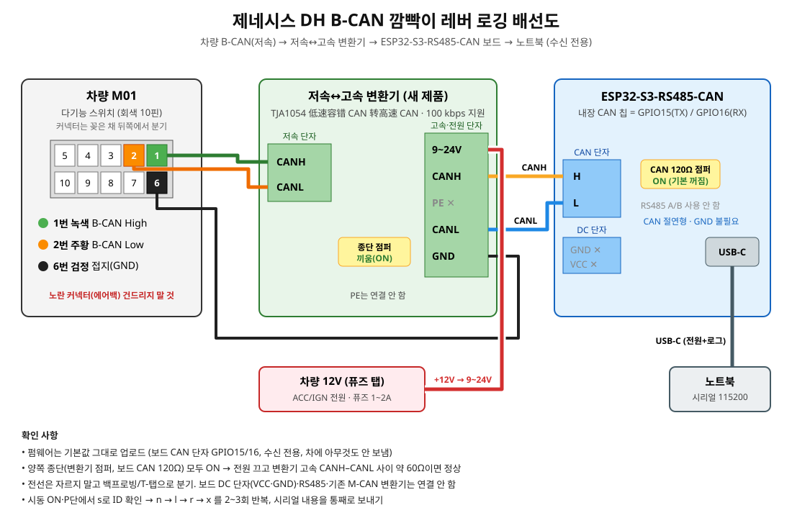

# 제네시스 DH B-CAN 깜빡이 레버 로거 (수신 전용)

깜빡이 레버(다기능 스위치 M01)가 B-CAN에 보내는 메시지를 찾는 펌웨어입니다.
**수신 전용(LISTEN_ONLY)** 이라 차에 아무 신호도 보내지 않고 ACK도 하지 않습니다.

- 보드: Waveshare ESP32-S3-RS485-CAN
- 차량 버스: DH B-CAN은 **저속(내결함) CAN**입니다. 보드에 내장된 CAN 칩은 고속용이라 B-CAN에 바로 연결하면 안 됩니다.

## 1. 준비물
- 저속 내결함 CAN 칩 모듈: **TJA1055T/3** (끝의 `/3` = 3.3 V 로직용)
- 노트북 + 데이터 전송이 되는 USB-C 케이블 (보드 전원과 로그 확인을 같이 함)
- 백프로빙 핀 또는 무절단 분기 커넥터(T-탭), 짧은 전선, 멀티미터

## 2. 배선 (방법 1: TJA1055 모듈, 기본값)

| 보드 헤더 | TJA1055 모듈 | 비고 |
|---|---|---|
| 5V | VCC | TJA1055는 5 V 전원 |
| GND | GND | |
| IO4 | TXD | 보드 → 칩 |
| IO5 | RXD | 칩 → 보드 |
| IO6 | EN | 펌웨어가 HIGH로 켬 (모듈에서 3.3 V에 직접 연결해도 됨) |
| IO7 | STB (STB_N) | 위와 같음 |

| TJA1055 모듈 | 차량 (M01 다기능 스위치, 회색 10핀) |
|---|---|
| CANH | **1번 녹색** (B-CAN High) |
| CANL | **2번 주황** (B-CAN Low) |
| GND | **6번 검정** (접지) |

- 모듈에 BAT(배터리 전원) 핀이 있으면 모듈 설명서대로 연결하세요. 없거나 내부 처리된 모듈이면 생략합니다.
- **보드 자체의 CAN H/L 단자(초록 단자대)에는 아무것도 연결하지 마세요.** 그건 고속 CAN 칩입니다.
- 커넥터는 뽑지 말고 꽂힌 상태에서 뒤쪽 전선에 백프로빙하거나 T-탭으로 분기합니다. 전선을 자르지 마세요.
- 옆의 **노란색 커넥터(에어백·클락스프링·조향각 센서)는 건드리지 마세요.**



### 방법 2: 저속↔고속 변환기 (예: TJA1054 "低速容错 CAN 转高速 CAN" 모듈)
보드 자체의 CAN 단자를 쓰고, 변환기를 차와 보드 사이에 넣습니다.

| 변환기 | 연결 |
|---|---|
| 저속 쪽 CANH | M01 **1번 녹색** |
| 저속 쪽 CANL | M01 **2번 주황** |
| 고속 쪽 CANH | 보드 CAN **H** 단자 |
| 고속 쪽 CANL | 보드 CAN **L** 단자 |
| 9~24V | 차량 12 V (퓨즈 달린 ACC/IGN 전원) 또는 12 V 어댑터 |
| GND | 차체 접지 (M01 6번 또는 차체 볼트), 보드 GND와 공통 |
| PE | 연결 안 함 |

- 변환기 고속 쪽과 보드 사이는 둘만 연결된 짧은 선이므로 **양쪽 끝 모두 120 Ω 종단을 켭니다**:
  변환기의 종단 점퍼를 끼우고, 보드의 120 Ω 점퍼(단자대 옆 노란 점퍼)도 켭니다.
  (차량 B-CAN 쪽은 건드리지 않습니다.)
- 펌웨어 맨 위를 이렇게 바꿉니다.
  ```
  #define CAN_TX_PIN 15
  #define CAN_RX_PIN 16
  #define FT_EN_PIN -1
  #define FT_STB_PIN -1
  ```
- 변환기가 **100 kbit/s를 지원하는지** 판매자에게 확인하세요(속도 고정형이면 맞아야 합니다).
- 속도는 맞는데 같은 프레임이 끝없이 반복되거나 아무것도 안 들어오면, 변환기가 내부 마이컴으로
  프레임을 다시 보내며 고속 쪽 ACK를 기다리는 방식입니다. 그때만 `#define CAN_ACK 1`로 바꿔
  다시 올리세요. ACK만 하고 데이터는 여전히 보내지 않습니다.

## 3. 펌웨어 올리기 (Arduino IDE)
1. Arduino IDE 설치 → 보드 매니저에서 **esp32 by Espressif (3.x)** 설치.
2. `tools/dh_bcan_logger/dh_bcan_logger.ino` 열기.
3. 도구 메뉴:
   - 보드: **ESP32S3 Dev Module**
   - USB CDC On Boot: **Enabled**
   - 나머지는 기본값
4. 보드를 USB-C로 연결하고 업로드. 포트가 안 보이면 BOOT 버튼을 누른 채 RESET을 눌렀다 떼고 다시 업로드.
5. 시리얼 모니터를 **115200**으로 열면 도움말이 나옵니다.

## 4. 레버 ID 찾는 순서
시리얼 모니터 입력창에 글자 하나를 넣고 Enter를 누르면 명령이 실행됩니다.

1. **시동 ON**(엔진은 꺼도 됨). P단, 비상등 끔.
2. `s` → 받은 ID 목록이 나오는지 확인합니다.
   - 아무것도 없으면 `a`(속도 자동 찾기). 그래도 없으면 배선, CANH/CANL 뒤바뀜, 모듈 EN/STB를 확인하세요.
3. `n` → **5초 동안 아무것도 만지지 않습니다.** 평상시에 원래 변하는 값(카운터 등)을 기억합니다.
4. `l` → 바로 **왼쪽 깜빡이 레버를 끝까지 올려 5초간 유지**합니다. 끝나면 결과가 나옵니다.
   ```
   ID 3xx  byte 2  bits 0x04   baseline 00  now 04   100% of 48 frames  <== held
   ID 1xx  byte 7  bits 0x40   baseline 3B  now 6D    40% of 50 frames
   ```
   "평소엔 안 변했는데 레버를 올리니 바뀐 비트" 목록입니다.
   - **`<== held` (80% 이상)**: 레버를 유지하는 동안 거의 모든 프레임에서 바뀐 비트 → 레버 후보
   - 비율이 낮은 것: 카운터나 점멸하는 램프 상태라서 레버가 아닙니다.
5. 레버를 내리고 `r` → **오른쪽 레버를 5초간 유지**합니다.
6. 레버를 내리고 `x` → **5초 동안 아무것도 만지지 않습니다**(대조 측정). 여기에도 나오는 ID·비트는 카운터 같은 것이라 **레버가 아닙니다.**
7. 3~6번을 **2~3번 반복**합니다. 매번 같은 ID·같은 바이트에서, 왼쪽과 오른쪽이 서로 다른 비트로 나오는 게 레버 메시지입니다.
   - 깜빡이 램프 상태 메시지(점멸에 맞춰 켜졌다 꺼졌다 하는 비트)도 같이 나올 수 있습니다. **레버 메시지는 유지하는 동안 값이 계속 같고**, 램프 메시지는 0.35초마다 바뀝니다.
8. 가능하면 **살짝 눌렀다 놓는 원터치(차선변경) 위치**도 `l`/`r`로 따로 해 봅니다.

### 그 밖의 명령
- `c`: 바뀐 값 실시간 출력 켜기/끄기 (기본 켜짐, 너무 많으면 끄세요)
- `v`: 모든 프레임 출력 (매우 많음)
- `m` 또는 보드 BOOT 버튼: 로그에 구분선(MARK) 넣기. 레버를 조작하기 직전에 누르면 나중에 찾기 쉽습니다.
- `b`: 통신 속도 수동 변경 (100k → 125k → 83.3k → 50k → 33.3k → 250k → 500k)

## 5. 결과 보내 주세요
시리얼 모니터 내용을 전부 복사해서 보내 주세요. 특히 다음이 필요합니다.
- `s` 출력 (속도, ID 목록)
- `n` → `l` → `r` → `x` 결과를 2~3회 반복한 것

이걸로 레버 메시지를 확인하면, 다음 단계에서 리모컨 차선변경 때 그 메시지를 보내는 기능을 만듭니다.
송신은 그때 따로 추가하며, 이 펌웨어는 끝까지 수신만 합니다.
